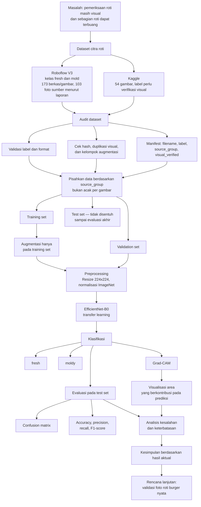

# Research Mind Map

Mind map berikut menunjukkan alur penelitian yang direncanakan. Ini bukan laporan bahwa eksperimen sudah dilakukan.

## Cara membaca
1. Audit label dan duplikasi dilakukan sebelum pembagian data.
2. Training hanya memakai training set; validation set dipakai untuk memilih konfigurasi.
3. Test set digunakan untuk evaluasi akhir dan tidak dipakai untuk memilih model.
4. Grad-CAM membantu melihat area yang memengaruhi prediksi, tetapi tidak membuktikan bahwa prediksi benar atau bahwa model mendeteksi jamur berdasarkan alasan yang tepat.
5. Kesimpulan dan rekomendasi operasional harus mengikuti hasil aktual.
